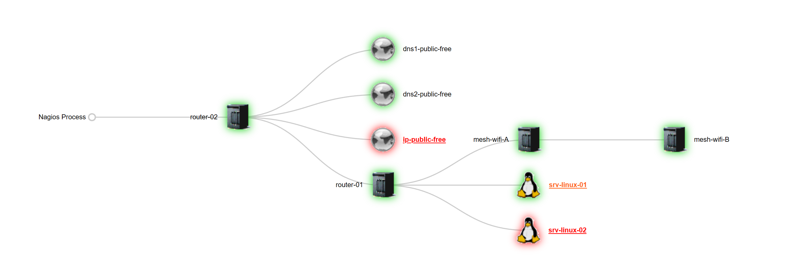
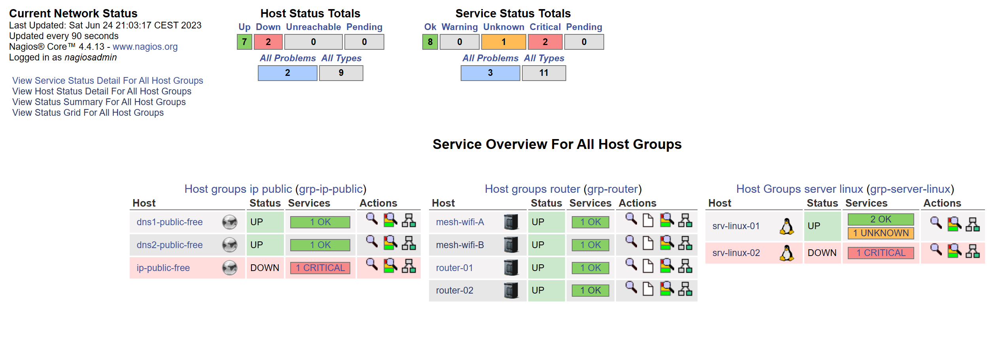

<!-- MASTER-HEADER-START -->
<div align="center">

<a href="https://0xcyberlitech.com/">
  
</a>

<p align="center">
  <a href="https://0xcyberlitech.com/"></a>
  <a href="https://0xcyberlitech.com/soc-rd.html"></a>
  <a href="https://0xcyberlitech.com/jarvis-rd.html"></a>
  <a href="https://github.com/0xCyberLiTech?tab=repositories"></a>
</p>
<p align="center">
  <a href="README.md"></a>
</p>


</div>
<!-- MASTER-HEADER-END -->

<!-- DEBIAN-TRUTH-START -->
> [!IMPORTANT]
>  ** Matrice Officielle Debian — `Debian 12 (Bookworm)` · `Debian 13 (Trixie)` · `Debian 14 (Forky)`**
> - **Sources Officielles Debian.org (`monitoring-plugins`) :** `Bookworm (12)` : **`2.3.3-5+deb12u2`** &nbsp;·&nbsp; `Trixie (13 — Stable)` : **`2.4.0-3+deb13u1`** &nbsp;·&nbsp; `Forky (14 — Next-Gen)` : **`2.4.0-5`**
> - **Références Officielles :** [Paquet Debian Trixie (`monitoring-plugins`)](https://packages.debian.org/trixie/monitoring-plugins) &nbsp;·&nbsp; [Paquet Debian Forky (`monitoring-plugins`)](https://packages.debian.org/forky/monitoring-plugins) &nbsp;·&nbsp; [Documentation Officielle Debian](https://packages.debian.org/trixie/monitoring-plugins)
> - **Note d'Ingénierie (Divergence 13 vs 14) :** Sous Debian 13 (Trixie) et Debian 14 (Forky), `/tmp` étant monté en RAM (`tmpfs`), toute compilation des sources Nagios Core doit s'effectuer dans **`/usr/local/src`** et utiliser le métapaquet `php` (PHP 8.4+).

<details>
<summary> <b>Afficher les Encarts Ligne de Commande : Debian 13 (Trixie — Stable) vs Debian 14 (Forky — Next-Gen)</b></summary>

####  Profil Production Stable — Commandes pour `Debian 13 (Trixie)`
```bash
# Debian 13 (Trixie — PHP 8.4 & /tmp en RAM tmpfs) : Compiler dans /usr/local/src et non /tmp !
sudo mkdir -p /usr/local/src && cd /usr/local/src
sudo apt update && sudo apt install -y build-essential apache2 php libgd-dev unzip
```

####  Profil Anticipation Next-Gen — Commandes pour `Debian 14 (Forky)`
```bash
# Debian 14 (Forky) — Utilisation des metapaquets 'php' & 'libapache2-mod-php' sans numero fige :
sudo /usr/local/nagios/bin/nagios -v /usr/local/nagios/etc/nagios.cfg
sudo systemctl restart nagios && sudo journalctl -u nagios -n 30
```

</details>
<!-- DEBIAN-TRUTH-END -->

<!-- CIEL-PEDAGOGY-START -->
<details>
<summary> <b>Synthèse d'Architecture, Standards Officiels &amp; Diagnostic (Niveau 1 : Fondamentaux · Niveau 2 : Repères · Niveau 3 : Diagnostic)</b></summary>

- **Niveau 1 — Fondamentaux &amp; Principe d'Architecture :** **Nagios Core & NRPE** forment un moteur déterministe d'ordonnancement de sondes (*Plugins*) : chaque contrôle local ou distant retourne un code d'état POSIX normalisé (`0 = OK`, `1 = WARNING`, `2 = CRITICAL`, `3 = UNKNOWN`) déclenchant les escalades d'alertes.
- **Niveau 2 — Repères Officiels (Ports IANA, Fichiers Debian &amp; Commandes de Validation) :** **Ports IANA :** `TCP 5666` (Agent distant NRPE chiffré TLS) · `TCP 80/443` (Interface Web Apache2 CGI) &nbsp;|&nbsp; **Fichiers :** `/usr/local/nagios/etc/nagios.cfg`, `/etc/nagios/nrpe.cfg` &nbsp;|&nbsp; **Validation officielle :** `sudo /usr/local/nagios/bin/nagios -v /usr/local/nagios/etc/nagios.cfg`.
- **Niveau 3 — Diagnostic d'Incidents &amp; Ingénierie Avancée :** **Diagnostic & Architecture :** Une erreur `CHECK_NRPE: Could not complete SSL handshake` indique généralement que l'IP du serveur Nagios est absente de la directive `allowed_hosts=` dans `/etc/nagios/nrpe.cfg` sur l'hôte supervisé ou que le port `5666/tcp` est filtré.
- **Sources de Vérité Officielles Éditeurs &amp; Standards :** [Documentation Officielle Nagios Core 4](https://assets.nagios.com/downloads/nagioscore/docs/nagioscore/4/en/) &nbsp;·&nbsp; [Référentiel Officiel Nagios Plugins](https://nagios-plugins.org/)
- **Livres Blancs &amp; 67 Podcasts Audio R&amp;D :** [Portail 0xCyberLiTech](https://0xcyberlitech.com/) &nbsp;·&nbsp; [Livre Blanc SOC Cockpit v5.5](https://0xcyberlitech.com/soc-rd.html) &nbsp;·&nbsp; [Livre Blanc JARVIS Mark-VII](https://0xcyberlitech.com/jarvis-rd.html) &nbsp;·&nbsp; [Blueprint Logiciel &amp; Matériel RTX 5080](https://0xcyberlitech.com/blueprint-jarvis.html)

</details>
<!-- CIEL-PEDAGOGY-END -->


#  Installation de Nagios Core 4.5.x & Nagios Plugins 2.4.x depuis les sources (Debian 12, 13 Trixie & 14 Forky)

Ce dossier technique détaille le déploiement complet de **Nagios Core `4.5.x` (`4.5.9+` Stable)** et des **Nagios Plugins `2.4.x` (`2.4.12+` Stable)** compilés depuis les sources officielles sur **Debian 12 (`Bookworm`)**, **Debian 13 (`Trixie` — Stable)** et **Debian 14 (`Forky` — Next-Gen)**.

---

##  01 // PRÉREQUIS & RÉPERTOIRE DE COMPILATION PERSISTANT


> [!WARNING]
> **Spécificité Critique Debian 13 (`Trixie`) & Debian 14 (`Forky`) :** Depuis Debian 13, le répertoire `/tmp` est monté par défaut **en mémoire vive (`tmpfs`)**. Ne compilez jamais vos sources dans `/tmp` : utilisez un répertoire disque persistant tel que **`/usr/local/src/nagios`** ou **`/opt/nagios`**.

<!-- CODE-WINDOW-START -->
> [!CAUTION]
> 
>
> ```bash
> sudo mkdir -p /usr/local/src/nagios
> cd /usr/local/src/nagios
> ```
<!-- CODE-WINDOW-END -->

###  A. Mise à jour du système Debian

<!-- CODE-WINDOW-START -->
> [!CAUTION]
> 
>
> ```bash
> sudo apt update && sudo apt full-upgrade -y
> ```
<!-- CODE-WINDOW-END -->

###  B. Installation des dépendances de compilation et de la pile Web (PHP 8.2 / 8.4+)

L'utilisation des métapaquets `php`, `php-gd` et `libapache2-mod-php` (sans numéro de version figé) installe automatiquement **PHP 8.2** sous Debian 12 (`Bookworm`) et **PHP 8.4+** sous Debian 13 (`Trixie`) / Debian 14 (`Forky`), pleinement supportés par **Nagios Core 4.5.x** :

<!-- CODE-WINDOW-START -->
> [!CAUTION]
> 
>
> ```bash
> sudo apt install -y \
>   autoconf \
>   build-essential \
>   gcc \
>   libc6 \
>   make \
>   wget \
>   unzip \
>   apache2 \
>   apache2-utils \
>   libapache2-mod-php \
>   php \
>   php-gd \
>   libgd-dev \
>   openssl \
>   libssl-dev \
>   curl
> ```
<!-- CODE-WINDOW-END -->

---

##  02 // TÉLÉCHARGEMENT & COMPILATION DE NAGIOS CORE 4.5.x (DERNIÈRE STABLE)


###  A. Récupération dynamique de la dernière release officielle (`nagios-4.5.9+`)

<!-- CODE-WINDOW-START -->
> [!CAUTION]
> 
>
> ```bash
> cd /usr/local/src/nagios
> NAGIOS_VER=$(curl -fsSL https://api.github.com/repos/NagiosEnterprises/nagioscore/releases/latest | grep tag_name | cut -d '"' -f 4)
> echo "Version Nagios Core détectée : ${NAGIOS_VER}"
> wget "https://github.com/NagiosEnterprises/nagioscore/releases/download/${NAGIOS_VER}/${NAGIOS_VER}.tar.gz"
> tar -xzf "${NAGIOS_VER}.tar.gz"
> cd "${NAGIOS_VER}"
> ```
<!-- CODE-WINDOW-END -->

###  B. Configuration, compilation et installation modulaire

<!-- CODE-WINDOW-START -->
> [!CAUTION]
> 
>
> ```bash
> ./configure --with-httpd-conf=/etc/apache2/sites-enabled
> make all
> sudo make install-groups-users
> sudo usermod -a -G nagios www-data
> sudo make install
> sudo make install-daemoninit
> sudo make install-commandmode
> sudo make install-config
> sudo make install-webconf
> ```
<!-- CODE-WINDOW-END -->

---

##  03 // CONFIGURATION APACHE2, AUTHENTIFICATION & PARE-FEU


###  A. Activation des modules Apache2 (`rewrite` & `cgi`)

<!-- CODE-WINDOW-START -->
> [!CAUTION]
> 
>
> ```bash
> sudo a2enmod rewrite cgi
> ```
<!-- CODE-WINDOW-END -->

###  B. Création du compte administrateur Web (`nagiosadmin`)

<!-- CODE-WINDOW-START -->
> [!CAUTION]
> 
>
> ```bash
> sudo htpasswd -c /usr/local/nagios/etc/htpasswd.users nagiosadmin
> ```
<!-- CODE-WINDOW-END -->

###  C. Redirection automatique de la racine Web vers `/nagios`

<!-- CODE-WINDOW-START -->
> [!CAUTION]
> 
>
> ```bash
> echo 'RedirectMatch ^/$ /nagios' | sudo tee /etc/apache2/conf-available/nagios-redirect.conf
> sudo a2enconf nagios-redirect
> ```
<!-- CODE-WINDOW-END -->

###  D. Vérification de la configuration et démarrage `systemd`

<!-- CODE-WINDOW-START -->
> [!CAUTION]
> 
>
> ```bash
> sudo /usr/local/nagios/bin/nagios -v /usr/local/nagios/etc/nagios.cfg
> sudo systemctl enable --now apache2 nagios
> sudo systemctl status nagios --no-pager
> ```
<!-- CODE-WINDOW-END -->

---

##  04 // COMPILATION & INSTALLATION DES NAGIOS PLUGINS 2.4.x (`2.4.12+`)


###  A. Dépendances des sondes système, SNMP et SSL (OpenSSL 3.x)

> [!NOTE]
> Sous **Debian 13 (`Trixie`)** et **Debian 14 (`Forky`)**, l'ancien paquet obsolète `libmcrypt-dev` n'est plus requis : le chiffrement des sondes s'appuie nativement sur **OpenSSL 3.x (`libssl-dev`)**.

<!-- CODE-WINDOW-START -->
> [!CAUTION]
> 
>
> ```bash
> cd /usr/local/src/nagios
> sudo apt install -y \
>   autoconf \
>   gcc \
>   libc6 \
>   make \
>   libssl-dev \
>   wget \
>   bc \
>   gawk \
>   dc \
>   build-essential \
>   snmp \
>   libnet-snmp-perl \
>   gettext \
>   fping \
>   dnsutils
> ```
<!-- CODE-WINDOW-END -->

###  B. Téléchargement automatique de la dernière version stable (`nagios-plugins-2.4.12+`)

<!-- CODE-WINDOW-START -->
> [!CAUTION]
> 
>
> ```bash
> cd /usr/local/src/nagios
> VER=$(curl -fsSL https://api.github.com/repos/nagios-plugins/nagios-plugins/releases/latest | grep tag_name | cut -d '"' -f 4 | sed 's/release-//')
> echo "Version Nagios Plugins détectée : ${VER}"
> wget "https://github.com/nagios-plugins/nagios-plugins/releases/download/release-${VER}/nagios-plugins-${VER}.tar.gz"
> ```
<!-- CODE-WINDOW-END -->

###  C. Fallback manuel si l'API GitHub est limitée

<!-- CODE-WINDOW-START -->
> [!CAUTION]
> 
>
> ```bash
> VER=2.4.12
> wget "https://nagios-plugins.org/download/nagios-plugins-${VER}.tar.gz"
> ```
<!-- CODE-WINDOW-END -->

###  D. Extraction, compilation et installation dans `/usr/local/nagios/libexec`

<!-- CODE-WINDOW-START -->
> [!CAUTION]
> 
>
> ```bash
> tar -xzf "nagios-plugins-${VER}.tar.gz"
> cd "nagios-plugins-${VER}"
> ./configure --with-nagios-user=nagios --with-nagios-group=nagios --with-openssl
> make
> sudo make install
> ```
<!-- CODE-WINDOW-END -->

---

##  05 // VALIDATION FINALE & INTERFACE WEB


###  A. Redémarrage propre des services `apache2` et `nagios`

<!-- CODE-WINDOW-START -->
> [!CAUTION]
> 
>
> ```bash
> sudo systemctl restart apache2 nagios
> sudo systemctl is-active apache2 nagios
> ```
<!-- CODE-WINDOW-END -->

###  B. Accès à la console Web Nagios Core

<!-- CODE-WINDOW-START -->
> [!CAUTION]
> 
>
> ```bash
> http://<IP_SERVEUR>/nagios
> http://<FQDN_SERVEUR>/nagios
> ```
<!-- CODE-WINDOW-END -->

- Connectez-vous avec l'identifiant **`nagiosadmin`** et le mot de passe défini via `htpasswd`.
- Vérifiez que l'ensemble des sondes (`PING`, `SSH`, `HTTP`, `Current Load`, `Root Partition`) passent à l'état **`OK`**.

###  C. Aperçu visuel en production

  


<!-- MASTER-FOOTER-START -->
<div align="center">


<a href="https://0xcyberlitech.com/">
  
</a>

<p align="center"><a href="https://0xcyberlitech.com/"></a></p>

<sub><b>Architecturé &amp; Forgé par Marc &amp; Antigravity (Google DeepMind)</b> &nbsp;·&nbsp; <a href="https://0xcyberlitech.com/"><b>0xcyberlitech.com</b></a> &nbsp;·&nbsp; <a href="https://0xcyberlitech.com/soc-rd.html">Architecture SOC Cockpit v5.5</a> &nbsp;·&nbsp; <a href="https://0xcyberlitech.com/jarvis-rd.html">Architecture JARVIS Mark-VII</a> &nbsp;·&nbsp; <a href="https://0xcyberlitech.com/blueprint-jarvis.html">Blueprint Matériel RTX 5080</a></sub>

</div>
<!-- MASTER-FOOTER-END -->
